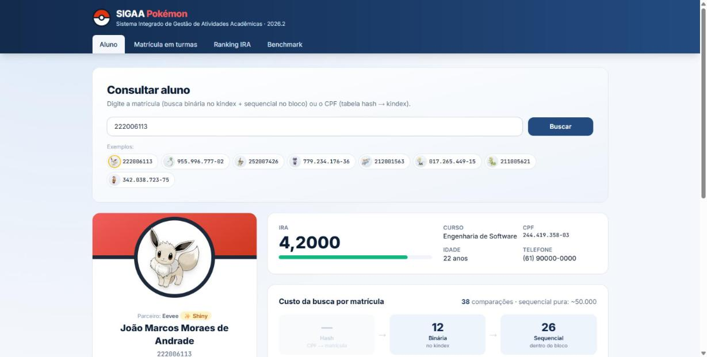
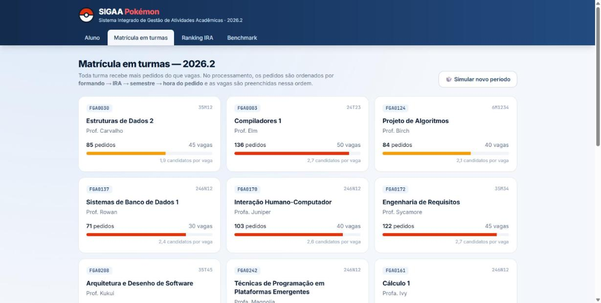
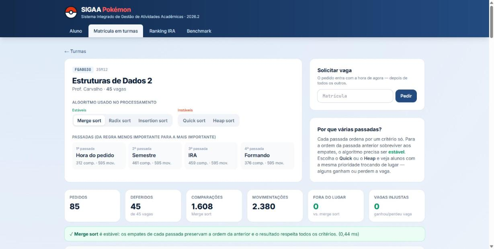
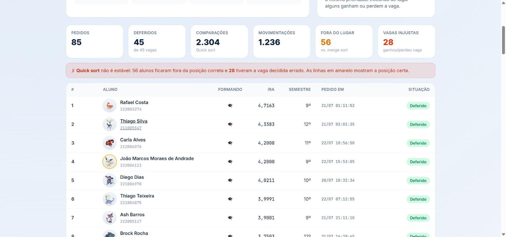
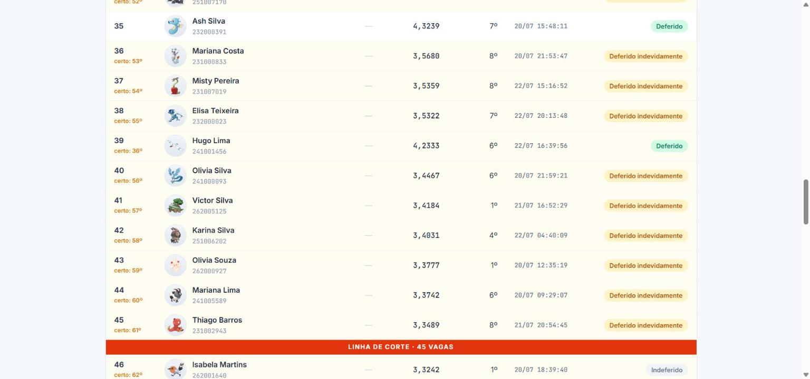
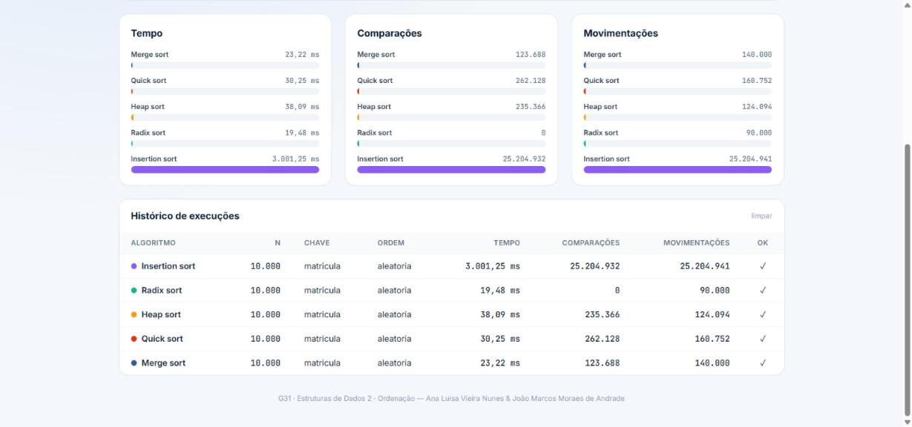

# G31_Ordenacao_EDA2-2026.2
Repositório dedicado ao Trabalho 2 (Ordenação) de Estruturas de Dados 2 do 2º semestre de 2026.

## Alunos
| Matrícula | Nome |
|-----------------------|---------------------|
| 23/2000660 | ANA LUISA VIEIRA NUNES |
| 22/2006113 | JOÃO MARCOS MORAES DE ANDRADE |

## Descrição do projeto

Este trabalho continua o [Trabalho 1 (Busca)](https://github.com/eda2-2026/G31_Busca_EDA2-2026.2), em que simulamos a base de alunos do SIGAA com busca sequencial indexada (kindex) e tabela hash por CPF. Agora o sistema ganhou uma interface web (o **SIGAA Pokémon** — cada aluno tem um Pokémon parceiro como avatar) e resolve um problema real do SIGAA com ordenação: **o processamento da matrícula em turmas**.

### O problema: quem fica com as vagas?

Toda turma recebe mais pedidos do que vagas. No processamento, os pedidos são ordenados por prioridade e as vagas vão sendo preenchidas nessa ordem:

1. **formando** primeiro (9º semestre em diante);
2. maior **IRA**;
3. **semestre** mais avançado;
4. pedido feito **mais cedo** (desempate final).

Em vez de um comparador com as 4 regras juntas, a ordenação é feita em **4 passadas**, da regra menos importante para a mais importante (hora → semestre → IRA → formando). Isso só funciona se o algoritmo for **estável**: na passada do IRA, dois alunos com o mesmo IRA precisam continuar na ordem que a passada do semestre deixou.

Na tela da turma dá para trocar o algoritmo do processamento. Com **merge**, **radix** ou **insertion** (estáveis) o resultado respeita todas as regras. Com **quick** ou **heap** (instáveis), os empates se embaralham: o sistema compara com o resultado correto, destaca quem ficou fora do lugar e conta quantos alunos **ganharam ou perderam a vaga injustamente**. Na turma de Estruturas de Dados 2 (85 pedidos, 45 vagas), o quick sort deixou 56 alunos fora da posição e 28 com a situação errada.

### Algoritmos implementados (`ordenacao.py`)

Todos foram implementados pela dupla, recebem uma função de chave e a direção (crescente/decrescente), e contam **comparações** e **movimentações**.

| Algoritmo | Estável | Complexidade | Detalhe da implementação |
|---|---|---|---|
| Merge sort | Sim | O(n log n) | De baixo para cima (sem recursão), intercalando pedaços de 1, 2, 4, 8... |
| Quick sort | Não | O(n log n) médio | Partição em 3 vias e pivô sorteado — aguenta chaves muito repetidas (ex.: "formando") |
| Heap sort | Não | O(n log n) | In-place, heap montada de baixo para cima |
| Radix sort (LSD) | Sim | O(d·n) | Counting sort estável por dígito; não compara elementos |
| Insertion sort | Sim | O(n²) | Referência "lenta" — limitado a 10.000 elementos |

### Onde a ordenação aparece no sistema

- **Matrícula em turmas**: o processamento descrito acima, com pedidos gerados em lote ("Simular novo período") ou feitos na hora pelo formulário "Solicitar vaga".
- **Kindex do Trabalho 1**: os blocos da busca indexada eram montados com o `sorted()` do Python; agora usam o nosso merge sort.
- **Ranking de IRA**: a base inteira (ou um curso) ordenada por IRA, com o algoritmo à escolha.
- **Benchmark**: amostras de 1.000 a 100.000 alunos, ordenadas por matrícula, CPF ou IRA, partindo de ordem aleatória, já ordenada ou invertida.
- **Corrida de algoritmos**: os mesmos 8 a 40 alunos ordenados pelos 5 algoritmos ao mesmo tempo, animados passo a passo (detalhes abaixo).

### Corrida de algoritmos

Quando a tela de corrida pede uma ordenação, o `Metricas` liga a gravação de passos e cada algoritmo anota o que fez: comparou A com B, trocou A e B, escreveu A na posição k (no vetor principal ou no auxiliar), fim de passada. O navegador só reproduz esses passos — a animação é exatamente o que as funções de `ordenacao.py` fizeram, e cada comparação ou movimentação gasta um "tique" da corrida, então quem chega primeiro é quem fez menos trabalho.

O que dá pra ver na tela:

- **Memória extra**: merge e radix escrevem num vetor auxiliar (a linha tracejada) e, no fim de cada passada, ele vira o principal. Quick, heap e insertion trabalham no próprio vetor.
- **Como cada um pensa**: o pivô do quick, as trocas de longa distância do heap, o insertion segurando um aluno "na mão" enquanto os maiores deslizam, o radix sem nenhuma comparação.
- **Estabilidade**: cada barra mostra a ordem de chegada (`#3`). Ao terminar, a pista confere os empates — ordenando por semestre, merge, radix e insertion mantêm os empatados na ordem de chegada, enquanto quick e heap trocam alguns de lugar (marcados em vermelho).
- **Entrada importa**: com a ordem inicial "Já ordenada", o insertion sort cai para O(n) e passa os outros.

Fora da corrida a gravação fica desligada (`passos = None`) e não muda o tempo do benchmark.

A busca do Trabalho 1 continua funcionando na tela **Aluno** (matrícula → kindex; CPF → hash → kindex), agora mostrando também a situação do aluno em cada turma que ele pediu.

A base sempre inclui um aluno fixo para demonstração: **222006113 — João Marcos Moraes de Andrade**, com uma Eevee shiny, que sempre pede vaga em Estruturas de Dados 2 e Projeto de Algoritmos (`ALUNOS_FIXOS` em `dados.py`).

### Comparação de desempenho

Amostras aleatórias da base, ordenadas por matrícula (Python 3.14):

| Algoritmo | n = 10.000: tempo | comparações | n = 100.000: tempo | comparações |
|---|---|---|---|---|
| Merge sort | 25 ms | 123.636 | 350 ms | 1.566.645 |
| Quick sort | 32 ms | 252.367 | 411 ms | 3.140.732 |
| Heap sort | 39 ms | 235.513 | 641 ms | 3.019.458 |
| Radix sort | 19 ms | 0 | 390 ms | 0 |
| Insertion sort | 2.963 ms | 24.997.941 | — | — |

O insertion sort faz ~200x mais comparações que o merge já com 10 mil elementos, enquanto os O(n log n) ficam abaixo de 1 segundo mesmo com 100 mil. O radix não compara elementos nenhuma vez: faz 9 passadas (uma por dígito da matrícula) movendo cada aluno.

## Guia de instalação

### Dependências do projeto

- Python 3.10 ou superior
- Flask (`pip install -r requirements.txt`)
- Navegador com internet (o Tailwind e as imagens dos Pokémon vêm de CDN)

### Como executar o projeto

1. Clone este repositório:
   ```
   git clone https://github.com/eda2-2026/G31_Ordenacao_EDA2-2026.2.git
   cd G31_Ordenacao_EDA2-2026.2
   ```
2. Instale as dependências:
   ```
   py -m pip install -r requirements.txt
   ```
3. Execute o servidor:
   ```
   py app.py
   ```
4. Abra http://127.0.0.1:5000 no navegador.

Na primeira execução o sistema gera uma base de 100.000 alunos, 16 turmas e um período de matrícula, salvos em `data/`. Para começar do zero, é só apagar essa pasta.

## Estrutura

| Arquivo | O que faz |
|---|---|
| `ordenacao.py` | Os 5 algoritmos de ordenação, com contagem de comparações e movimentações (e gravação de passos para a corrida) |
| `matricula.py` | Regras de prioridade e processamento da matrícula em passadas estáveis |
| `busca.py` | Kindex + tabela hash do Trabalho 1 (blocos montados com merge sort) |
| `dados.py` | Geração e persistência em CSV de alunos, turmas e pedidos |
| `app.py` | Servidor Flask: páginas e API JSON |
| `templates/`, `static/` | Frontend (HTML + Tailwind + JavaScript) |

## Vídeo de apresentação

- Vídeo do João Marcos apresentando o projeto: _(link)_
- Vídeo da Ana Luisa apresentando o projeto: _(link)_

## Capturas de tela

**Consulta de aluno** — busca por matrícula/CPF e custo em comparações


**Turmas** — pedidos x vagas de cada turma


**Processamento com merge sort** — as 4 passadas e nenhuma vaga injusta


**Processamento com quick sort** — mesma turma, algoritmo instável


**Linha de corte com quick sort** — alunos deferidos indevidamente e a posição em que deveriam estar


**Ranking de IRA**


**Benchmark** — 10.000 alunos ordenados por matrícula


## Conclusões

O ponto central do trabalho foi a **estabilidade**. Ordenar por vários critérios em passadas, do menos para o mais importante, é simples e fácil de explicar, mas só dá o resultado certo com um algoritmo estável. No processamento de matrícula isso deixa de ser detalhe teórico: um quick sort no lugar do merge tira a vaga de quem tinha direito.

Nos testes de desempenho, o merge sort foi o mais equilibrado: estável, sempre O(n log n) e o mais rápido entre os que comparam. O radix sort foi competitivo para chaves inteiras curtas, e o insertion sort mostrou na prática o custo do O(n²).

Limitações e trabalhos futuros: o processamento trata cada turma de forma independente (não verifica choque de horário nem limite de créditos por aluno) e o IRA é sorteado, não calculado a partir de notas.

## Referências

- Material e slides da disciplina de Estruturas de Dados 2 (EDA2)
- Documentação oficial do Python: https://docs.python.org/3/
- Flask: https://flask.palletsprojects.com/
- Imagens dos Pokémon: [PokéAPI](https://pokeapi.co/)
